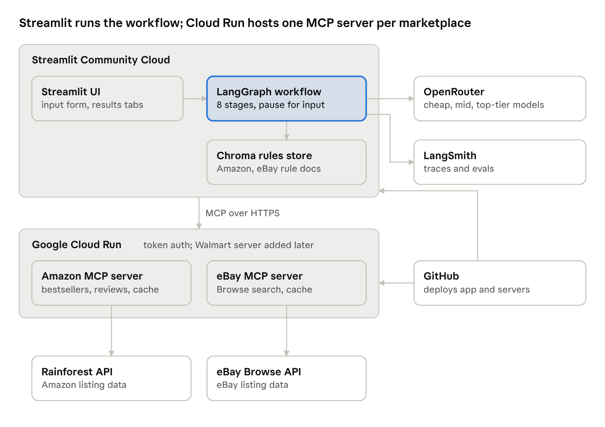

# EnrichDescription

Describe your product once. Get a marketplace-ready listing for Amazon and eBay, based on
what top sellers in your category do right now and checked against each marketplace's rules.

**Live demo:** https://enrichdescription.streamlit.app/ · **PRD:** [docs/PRD.md](docs/PRD.md)



## How it works

A LangGraph workflow runs inside the Streamlit app:

| Stage | What happens | Model tier |
| --- | --- | --- |
| Policy and category | Drops marketplaces where the item is prohibited; stops on unsupported categories | Cheap (`qwen/qwen3.6-35b-a3b`) |
| Attributes | Extracts size/fit/fabric or device/material; pauses once to ask for anything missing | Cheap |
| Competitor listings | One MCP server per marketplace (eBay Browse API, Rainforest for Amazon), cached 24 h | — |
| Relevance filter | Removes listings for a different product type | Mid (`minimax/minimax-m3`) |
| Generate | Extracts patterns (not words) from top listings and writes title, bullets, description, keywords | Top (`deepseek/deepseek-v4.1-flash`) |
| Rules check | Length, repeated words, special characters, and an 8-word copy check; one automatic fix pass | Code |

Sellers rate each listing 1–5 stars; ratings and edits are logged to LangSmith as eval data.

## Repo layout

```
streamlit_app.py      UI (input, missing-attribute form, results, star rating)
enrich/               workflow, prompts, schemas, model tiers, rules checks, MCP client
mcp_servers/          eBay + Amazon MCP servers in one ASGI app (deployed to Cloud Run)
tests/                unit tests and workflow paths with fake models (no keys needed)
docs/                 PRD and diagrams
Dockerfile            image for the MCP servers
```

## Run locally

Needs [uv](https://docs.astral.sh/uv/).

```bash
uv sync
cp .env.example .env        # then fill in your own keys; never commit .env
uv run pytest               # no keys needed
```

Start the MCP servers, then the app, in two terminals:

```bash
uv run --env-file .env uvicorn mcp_servers.app:app --port 8080
```

```bash
uv run --env-file .env streamlit run streamlit_app.py
```

## Deploy

**MCP servers → Google Cloud Run.** Put the secrets in Secret Manager first
(`ebay-client-id`, `ebay-client-secret`, `rainforest-api-key`, `mcp-auth-token`), then:

```bash
gcloud run deploy enrich-mcp --source . --region us-central1 --allow-unauthenticated --set-secrets EBAY_CLIENT_ID=ebay-client-id:latest,EBAY_CLIENT_SECRET=ebay-client-secret:latest,RAINFOREST_API_KEY=rainforest-api-key:latest,MCP_AUTH_TOKEN=mcp-auth-token:latest --set-env-vars EBAY_ENV=production
```

`--allow-unauthenticated` only opens the network path; every MCP request still needs the
bearer token. Check it with `curl https://<service-url>/healthz`.

**App → Streamlit Community Cloud.** Point the app at `streamlit_app.py` on `main`, and
paste the values from [.streamlit/secrets.toml.example](.streamlit/secrets.toml.example)
into *App settings → Secrets*, using your Cloud Run URL.

## Status

M1 scaffold: the workflow, both MCP servers, the UI and the rules checks are in place.
Next: rules RAG in Chroma (M2), then the LangSmith golden set and model comparison (M4).
See the milestones in the [PRD](docs/PRD.md#milestones).

## License

Apache 2.0, see [LICENSE](LICENSE).
