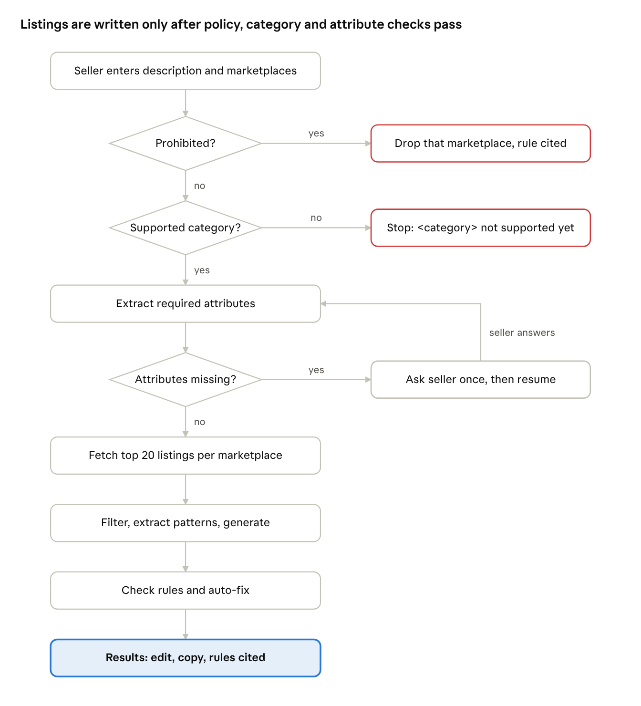
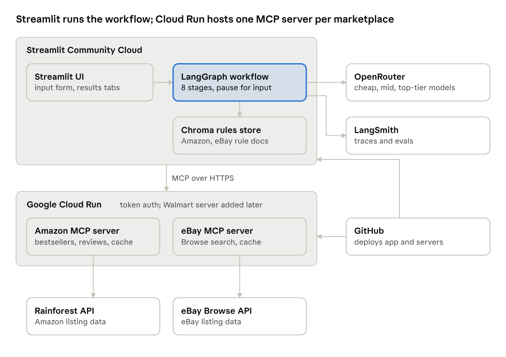

# EnrichDescription — Product Requirements Document

Nov 17, 2026 · Babu Pasupathy

> Snapshot of the working PRD (kept in Claude Docs). Update this file when the PRD changes.

## Overview

EnrichDescription turns one raw product description into a compliant, marketplace-ready listing (title, bullets, description, keywords) for each marketplace a US small seller chooses, grounded in what top sellers in that category are doing right now.

**Problem.** Small sellers who list on several marketplaces rewrite the same product for each one. Each marketplace has its own title limits, style rules and prohibited claims. Sellers rarely know which keywords and attributes the bestsellers in their category use, so their listings rank and convert poorly.

**Why us, given the built-in AI tools.** Amazon, eBay and Walmart each offer a free AI listing writer, but each works for its own marketplace only and starts from the seller's text alone. EnrichDescription differs on three points:

- **One input, many marketplaces.** Describe the product once and get a version for each marketplace.
- **Grounded in competitors.** It studies the top 20 current listings per marketplace and borrows their patterns, not their words.
- **Checked against the rules.** It checks every output against each marketplace's written rules and cites the rule behind each fix.

## Goals and non-goals

**Product goals**

1. A seller gets ready-to-paste listings for up to two marketplaces in under 60 seconds.
2. Every listing passes the marketplace's rules (length, banned claims, trademark use) before it is shown.
3. Sellers rate the listings 4 or 5 stars.
4. Cost stays low enough to run a public demo for a few months on a small budget.

**Portfolio goal.** Show AI product management skill end to end: problem framing, scoping, model routing by cost and quality, evals that drive decisions, safety guardrails, and a working public demo.

**Non-goals for the MVP**

- Walmart, Etsy (planned for a later phase).
- Categories other than women's dresses and cell phone cases.
- Publishing listings straight to a marketplace. For now, the seller copies and pastes them.
- Image generation or image analysis.
- Pricing advice.

## Target user and stories

**Persona: Maria, a multi-channel small seller.** Maria runs a two-person US business selling women's dresses or phone cases on Amazon and eBay. She writes listings herself, has no copywriter and doesn't know any SEO tools. A typical batch is 5–20 new products a month.

**User stories**

- As a seller, I paste my rough product notes and choose marketplaces, so that I get one listing per marketplace without rewriting.
- As a seller, I'm told right away if my product is prohibited or not supported yet, so that I don't waste time.
- As a seller, I'm asked only for the attributes I left out (such as size, fabric or compatible device), so that the listing is complete.
- As a seller, I see which keywords and patterns from top listings were used, so that I trust the output.
- As a seller, I see which marketplace rule caused each change, so that I learn the rules.
- As a seller, I edit the output inline and copy each field with one click.

## Scope

The MVP covers Amazon and eBay for two categories. Walmart comes in a later phase.

| Marketplace | Phase | Listing data source | Ranking used |
| --- | --- | --- | --- |
| Amazon | MVP | Rainforest API (bestsellers + product + reviews) | Bestseller rank; ratings if there's no bestseller list |
| eBay | MVP | eBay Browse API (production keyset) | Best match, then seller feedback and watch count |
| Walmart | Later | To be decided (licensed data API) | Best seller sort |
| Etsy | Later | To be decided | Best ratings sort |

| Category | Required attributes | Amazon source | eBay source |
| --- | --- | --- | --- |
| Women's dresses | Size, fit, fabric (plus color, length, sleeve and occasion if given) | [Dresses node 1045024](https://www.amazon.com/Dresses/b/ref=sv_sl_fl_1045024?ie=UTF8&node=1045024) | Browse search by category ID |
| Cell phone cases | Compatible device, material (plus protection level and features if given) | [Cases node 2407760011](https://www.amazon.com/cell-phone-cases-screen-protectors/b/?ie=UTF8&node=2407760011&ref_=sv_e_4) | Browse search by category ID |

Anything outside these two categories is told support is coming soon.

## User flow

Two checks can stop a run, and one can pause it, all before any marketplace data is fetched. Only the attribute check loops back, after the seller answers once.

## Functional requirements

The pipeline has eight stages, from input to results. Each stage uses the cheapest model that meets its quality bar in evals.

| # | Stage | Model tier | Requirement |
| --- | --- | --- | --- |
| F1 | Input | — | The seller enters a raw description (up to 2,000 characters) and chooses one or more marketplaces. |
| F2 | Policy and category check | Cheap | First checks the description against each chosen marketplace's prohibited and restricted rules (from RAG): weapons, adult content, violence, drugs, counterfeit or replica, recalled or hazardous items. If prohibited, it says "This category is prohibited on \<marketplace\>," cites the rule and drops that marketplace. The other marketplaces continue; the run stops only if every chosen marketplace prohibits it. Then it sorts the item into a supported category and subcategory. If the category isn't supported, it says "Sorry! Support for this category \"\<category\>\" is coming soon" and stops. |
| F3 | Attribute extraction | Cheap | Pulls out the required attributes for the category. If any are missing, it pauses and asks the seller in one form, then continues. |
| F4 | Competitor listings (MCP) | — | One MCP server per marketplace returns up to 20 current listings: title, description or bullets, price, rating, review count, sales signal where available, and a sample of reviews. Results are cached for 24 hours per marketplace and category. |
| F5 | Relevance filter | Mid | Removes listings that don't match the product's subcategory and key attributes (for example, an iPhone 16 case against a Galaxy listing). Keeps at least 5, or warns the seller. |
| F6 | Pattern extraction and generation | Top | Picks the strongest listings and extracts patterns: top keywords, title structure, attributes buyers mention in reviews. Never copies or paraphrases competitor text. Writes the title, bullets, description and keywords for each marketplace, following its rules (RAG). It also returns the patterns it used. |
| F7 | Compliance check and fix | Cheap + rules code | Code checks length limits, repeated words and special characters. A model checks for banned claims and trademark misuse. It fixes issues automatically, cites the rule for each fix and shows any remaining warnings. |
| F8 | Results UI | — | One tab per marketplace showing each field with a character count, a copy button and an inline editor, plus a "Patterns used" panel and a "Rules applied" panel. The seller can regenerate one field at a time. Under each listing, a one-tap question asks "How good is this listing?" with 1–5 stars. At 3 stars or below, optional reason tags appear: wrong keywords, wrong tone, missing details, too long. |

## Architecture and tech stack

The LangGraph workflow is the core. It runs inside the Streamlit app, reads rules from Chroma, calls models through OpenRouter and gets marketplace data only through the MCP servers.

| Layer | Choice | Why |
| --- | --- | --- |
| UI | Streamlit Community Cloud | Free, deploys from GitHub, fastest to build |
| Orchestration | LangGraph + LangChain | Branches to stop, runs marketplaces in parallel, pauses for seller input |
| Models | OpenRouter: cheap = Qwen3.6-35B-A3B, mid = MiniMax M3, top = DeepSeek V4.1 Flash | One key for all models; each choice is confirmed or swapped by eval results; pin to US-hosted providers |
| RAG | Chroma, stored as files in the repo, with small local embeddings | Small rule set; filter by marketplace and category; cite the rule used |
| Marketplace data | One MCP server per marketplace (FastMCP, streamable HTTP) on Cloud Run, all in one container | Separate services; reusable from Claude Desktop or Cursor; scales to zero |
| Evals and tracing | LangSmith | Golden set, judge models, cost and speed per run |
| Code | [GitHub: EnrichDescription](https://github.com/babupasupathy/EnrichDescription) (public) | Portfolio; CI runs the eval suite |

## Data sources and constraints

Each field comes only from a source that actually provides it. Fields no source provides are dropped from the MVP.

| Field | Amazon (Rainforest) | eBay (Browse API) |
| --- | --- | --- |
| Title | Yes | Yes |
| Description or bullets | Yes (product request) | Short description; full text via the getItem call |
| Price | Yes | Yes |
| Rating and review count | Yes | Seller feedback only, no product rating |
| Bestseller rank | Yes (bestsellers request) | No; best match order |
| Sold last month | "Bought in past month" badge, on some items only | No |
| Sold today | Dropped: no source provides it | Dropped |
| Review comments | Yes (reviews request, 1 credit each) | No |
| Listed in past 3 months | Can't filter; use current bestsellers as a stand-in | Can filter by item start date where available |

**Constraints**

- **Rainforest credits.** One run costs about 1 bestsellers request, up to 20 product requests and up to 20 review requests. A 24-hour cache per category means most runs use zero credits.
- **eBay production keyset.** Set up the Marketplace Account Deletion notification, or the exemption, to keep the keyset active. Use an application token (OAuth client credentials). Sandbox data is only for tests.
- **Terms of service.** No scraping of marketplace sites. Data comes only from licensed APIs.

## Success metrics and evals

The north-star metric is **listings rated 4 or 5 stars**: the share of rated listings that sellers give 4 or 5 stars, from a one-tap question under each listing (like Uber or Netflix). In offline evals, a judge model gives the same 1–5 rating.

| Metric | Target (MVP) | How it's measured |
| --- | --- | --- |
| Rated 4–5 stars | ≥ 70% | Star question under each listing, with reason tags at 3 stars or below; also track the response rate (% of listings rated). The judge model gives the same rating in evals. |
| Rule compliance pass rate | 100% on code checks, ≥ 95% on model checks | Deterministic checkers + LangSmith judge |
| Prohibited-item catch rate | ≥ 98%, false positives ≤ 5% | Labelled adversarial set |
| Category accuracy | ≥ 95% | Labelled set |
| No copying from competitors | 0 phrases of 8+ words copied | N-gram overlap check against the fetched listings |
| Time to first result | ≤ 60 s (cached), ≤ 120 s (fresh) | LangSmith traces |
| Cost per run | ≤ $0.05 in model calls | LangSmith token cost + OpenRouter usage |

**Eval plan (LangSmith)**

- **Golden set.** 40 products: 15 dresses, 15 phone cases, 5 prohibited (including tricky ones like a "replica designer dress" or "case with built-in knife") and 5 unsupported categories.
- **Graders.** Code checks for length, banned words and copying. A judge model scores keyword coverage, clarity, attribute completeness and marketplace fit on a 1–5 scale.
- **Model selection.** Start with Qwen3.6-35B-A3B (cheap), MiniMax M3 (mid) and DeepSeek V4.1 Flash (top). Compare each with one alternative and one frontier model as a quality ceiling, then publish the comparison in the README.
- **Regression.** Re-run the golden set on every prompt or model change before merging. Sellers' final edits from the demo are added to the golden set as new reference examples.

## Security, privacy and cost guardrails

- **Secrets.** No keys in code or chat. Keys live in Streamlit secrets and Google Secret Manager (for Cloud Run). Commit a `.env.example` file, keep `.env` in `.gitignore`, and turn on GitHub secret scanning and push protection. Rotate any key that was ever exposed.
- **MCP auth.** The Cloud Run MCP servers accept only requests carrying a shared bearer token from the app. They aren't open to the public internet.
- **Spend caps.** Set a monthly credit limit on the OpenRouter key and a budget alert in Google Cloud. Watch the Rainforest credit balance.
- **Abuse limits.** Allow 10 runs per browser session per hour and cap input at 2,000 characters.
- **Privacy.** No seller accounts. Seller inputs and final edits are saved in LangSmith as eval data, and the About page says so. Pin OpenRouter to US-hosted providers and say so on the About page.
- **Content safety.** The prohibited-item check (F2) runs before any data fetch or generation.

## Risks and open questions

| Risk | Impact | Mitigation |
| --- | --- | --- |
| Rainforest credits run out during a demo | Amazon results fail | 24-hour cache, a pre-warmed snapshot as fallback, and a visible "data as of" date |
| eBay production keyset is disabled | eBay results fail | Set up the account-deletion notification on day 1; fall back to cached data |
| Cheap models miss tricky prohibited items | Unsafe output | Adversarial eval set and a blocking threshold; escalate low-confidence cases to the mid-tier model |
| Output copies competitor text | IP and trust risk | Patterns-only prompt plus an n-gram overlap check that blocks the output |
| Marketplace rules change | Outputs break the rules | Rule documents carry a "retrieved on" date; review them monthly |
| Free-tier cold starts (Streamlit, Cloud Run) | Slow first run | Open the app before demos; set Cloud Run minimum instances to 0 or 1 depending on budget |

**Decisions**

- **Models:** cheap = Qwen3.6-35B-A3B, mid = MiniMax M3, top = DeepSeek V4.1 Flash, all through OpenRouter.
- **Prohibited items:** stop only the marketplace that prohibits the item; the others continue.
- **Eval data:** sellers' final edits are kept as eval data. There's no consent step because this is a demo.
- **Unsupported message:** `Sorry! Support for this category "<category>" is coming soon`, with no waitlist email.

## Milestones

Each milestone ships to the live Streamlit app and has an exit check before the next one starts. Dates are to be set once you confirm scope.

1. **M1: Foundations.** Repo, secrets setup, eBay MCP server on Cloud Run, a basic LangGraph workflow, and a Streamlit page that returns a generated eBay listing.
   - Exit: a real eBay listing generated end to end on the public URL.
2. **M2: Guardrails.** Rules RAG in Chroma, the policy and category check (F2), attribute extraction with the pause for missing attributes (F3), and the compliance check (F7).
   - Exit: prohibited, unsupported and missing-attribute cases behave as in the user flow.
3. **M3: Amazon.** Rainforest MCP server, a 24-hour cache, parallel runs across marketplaces, the relevance filter (F5) and the "Patterns used" panel.
   - Exit: Amazon and eBay listings from one input in ≤ 120 seconds.
4. **M4: Evals and model choice.** A 40-item golden set in LangSmith, graders, a comparison of 2–3 models per stage, and CI regression runs.
   - Exit: metric targets met and the model comparison published in the README.
5. **M5: Portfolio package.** README with the architecture diagram, demo GIF, before/after gallery, cost per listing, 3–5 seller interviews and this PRD.
   - Exit: ready to share with prospective companies.
6. **Later: Walmart, Etsy.** A third & fourth MCP server through a licensed data API.
